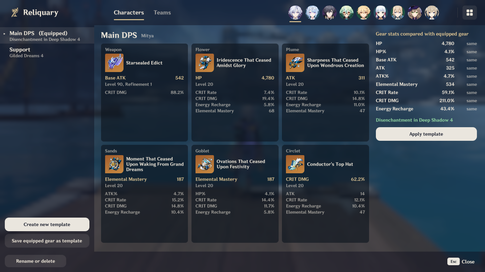
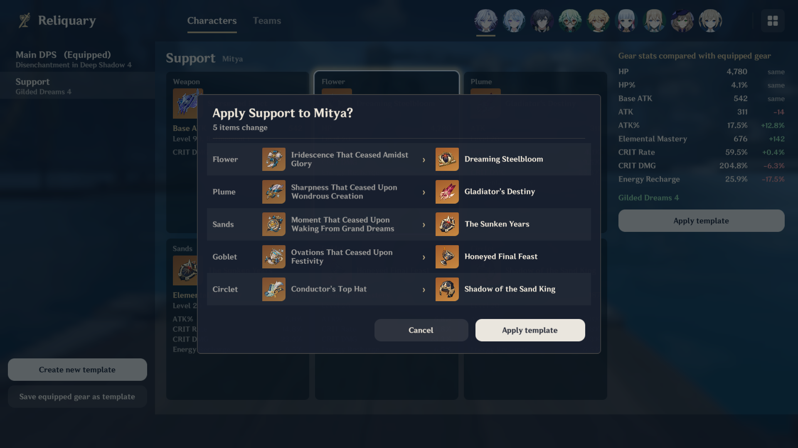
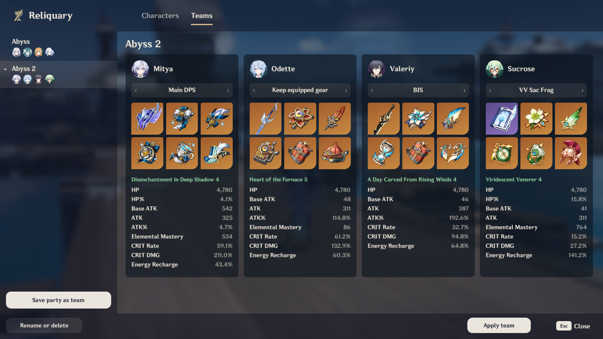
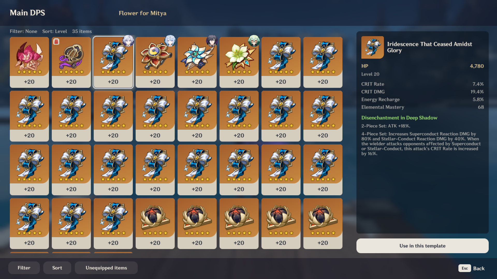

<div align="center">

# Reliquary

**Gear templates for Genshin Impact**

Create weapon and artifact templates for your characters and teams, and apply them from a full-screen menu.

[Features](#features) · [Screenshots](#screenshots) · [Installation](#installation) · [Getting started](#getting-started) · [Applying](#applying) · [Building](#building)

</div>

---

## Features

| | |
|--|--|
| **Character templates** | Any number of named templates per character, each with a weapon and five artifacts. |
| **Team templates** | One character template per member, so a change to that template reaches every team that uses it |
| **Stat comparison** | Each template's stats next to the equipped gear's, with the difference for every stat |
| **Item picker** | Filter weapons by secondary attribute and artifacts by set. Sort artifacts by up to three affixes. See who holds each item. |
| **Safe applying** | Every change is listed before it happens, and Undo puts the old gear back |

## Screenshots

<table>
<tr>
<td width="50%" valign="top">
  
  <p align="center"><sub>A character template and its stats compared with the equipped gear</sub></p>
</td>
<td width="50%" valign="top">
  
  <p align="center"><sub>Every change is listed before the template is applied</sub></p>
</td>
</tr>
<tr>
<td width="50%" valign="top">
  
  <p align="center"><sub>A team template with one character template per party member</sub></p>
</td>
<td width="50%" valign="top">
  
  <p align="center"><sub>The item picker screen</sub></p>
</td>
</tr>
</table>

## Installation

This mod requires a [custom build of MelonLoader](https://github.com/portra400nc/melon/releases) that supports Genshin.

1. Download the latest release from the [Releases](https://github.com/portra400nc/Reliquary/releases) page.
2. Copy `Reliquary.dll` into MelonLoader's `Mods` folder.

To update, replace the file with the one from the new release. To uninstall, delete it. Your templates stay in `UserData/Reliquary/`, saved per account.

## Getting started

Open Paimon menu, then:

- **Mouse:** click the Reliquary tile.
- **Controller:** press <kbd>Y</kbd>.

1. In the **Characters** tab, select **Save equipped gear as template**, or **Create new template** to start an empty one.
2. Select a slot, such as **Flower**, to choose its item in the item picker, then select **Use in this template**.
3. Select **Apply template**.
4. In the **Teams** tab, select **Save party as team**. You can then specify each party member's gear template and apply all of them in one click.

## Applying

Reliquary lists every change first. Equipping an item another character holds gives that character your old item, as in the game. Right after applying, select **Undo** to put the old gear back.

- A team is not applied when two members need the same item.
- Deleting a template asks first.
- Items you no longer own are skipped.

## Limits

- The comparison adds up the items' own stats. It leaves out set bonuses and the character's base stats.
- The game's controller navigation does not reach the tile, so controllers use <kbd>Y</kbd>.
- Artifacts cannot be taken off, because the mod has no request for that.

## Building

You need the .NET 6 SDK or newer and a custom MelonLoader install whose `MelonLoader/net6` and `MelonLoader/Il2CppAssemblies` hold the references.

```sh
dotnet build Reliquary -c Release \
  -p:MelonLoaderNet6=<game folder>/MelonLoader/net6 \
  -p:Il2CppAssemblies=<game folder>/MelonLoader/Il2CppAssemblies
```

Copy `Reliquary/bin/Release/Reliquary.dll` to the game's `Mods` folder.

The tests cover how templates are applied, the item picker's filters and sorting, and the scrolling. They need the .NET 9 SDK but no game files:

```sh
dotnet run --project Reliquary.Tests
```
